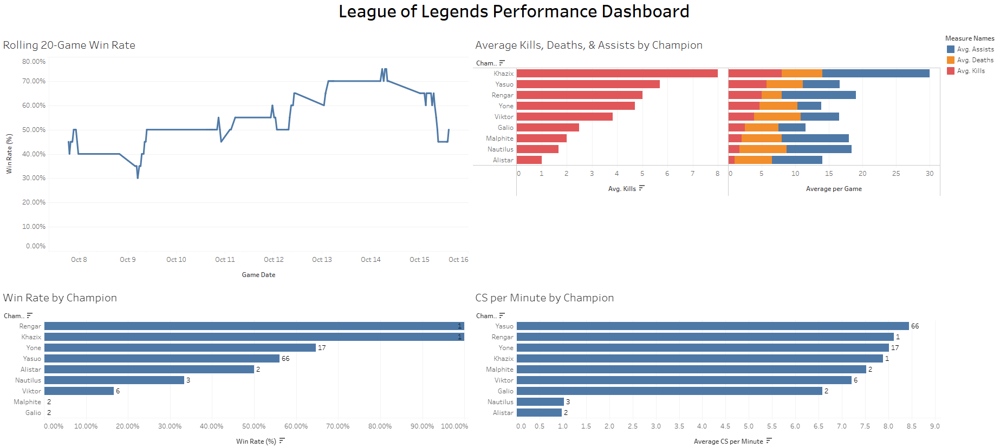

# League of Legends Performance Analyzer

A Python, SQL, and Tableau analytics project that collects, stores, analyzes, and visualizes ranked League of Legends match data using the Riot Games API and MySQL.

## Project Overview

This project retrieves up to 100 recent Ranked Solo/Duo matches from the Riot Games API and stores match data in a MySQL database. Python is used to calculate performance metrics, generate CSV reports, create visualizations, and run automated tests.

The analysis covers win-rate trends, champion performance, kills/deaths/assists (KDA), CS per minute, gold per minute, and damage per minute. Role-based filtering allows performance to be analyzed for a specific position or across all roles.

## Tableau Dashboard

Explore the interactive dashboard on Tableau Public:

**[View the League of Legends Performance Dashboard](https://public.tableau.com/app/profile/kevin.lim7109/viz/LeagueofLegendsPerformanceDashboard/Dashboard)**



The dashboard visualizes rolling win rate, champion win rate, average KDA, and CS per minute to analyze ranked match performance.

## Features

- **Automated Data Import:** Retrieves ranked match data from the Riot Games API, with retry handling for API rate limits.
- **MySQL Database:** Stores match history and prevents duplicate records using match IDs.
- **Performance Analytics:** Calculates win rates, KDA, CS per minute, gold per minute, and damage per minute.
- **Champion Analysis:** Compares champion performance by games played, win rate, KDA, and CS per minute.
- **Win-Rate Trends:** Visualizes cumulative win rate and a rolling 20-game win rate.
- **Win/Loss Comparison:** Compares gameplay statistics between wins and losses.
- **CSV Reporting:** Exports match history, champion performance, role performance, and win/loss comparison reports.
- **Data Quality Checks:** Checks for missing values and duplicate match IDs.
- **Automated Testing:** Uses pytest to validate analytical functions.
- **Configurable Role Analysis:** Allows analysis of a selected role or all roles through `config.py`.

## Visualizations

The following charts are generated from the local MySQL database. The current configuration focuses on middle lane.

### Ranked Win-Rate Trends


The cumulative line tracks win rate across matches played. The rolling line measures win rate over the most recent 20 included games.

### Champion Win Rate


Compares win rates across champions, with the number of games played shown alongside each champion.

### Champion KDA


Compares average kills, deaths, and assists per game across champions.

### Champion CS per Minute


Compares average creep score per minute across champions.

## Technologies Used

- Python
- SQL and MySQL
- pandas
- matplotlib
- Riot Games API
- requests
- python-dotenv
- pytest
- Tableau Public
- Git and GitHub

## Project Structure

| File or folder | Purpose |
|---|---|
| `import_ranked_matches.py` | Retrieves ranked matches and inserts new records into MySQL |
| `analyze_matches.py` | Calculates performance metrics and exports CSV reports |
| `plot_win_rate.py` | Generates cumulative and rolling win-rate trends |
| `plot_champion_stats.py` | Generates champion performance charts |
| `config.py` | Configures the role used for analysis |
| `test_analysis.py` | Tests analytical functions |
| `charts/` | Stores generated Python charts and the Tableau dashboard screenshot |
| `champion_performance_report.csv` | Champion-level performance metrics |
| `role_performance_report.csv` | Performance metrics by role |
| `ranked_match_history.csv` | Exported ranked match history |
| `win_loss_comparison_report.csv` | Compares statistics between wins and losses |
| `.env` | Local API key and database credentials; excluded from version control |

## Setup and Usage

### 1. Install Prerequisites

Install Python, MySQL Server, and Git.

### 2. Install Python Dependencies

Run the following command in your terminal from the project directory:

```bash
pip install requests python-dotenv mysql-connector-python pandas matplotlib pytest
```

### 3. Configure Credentials

Create a local `.env` file in the project folder containing your Riot API key and MySQL connection settings.

Never commit this file to GitHub or expose your API key publicly.

### 4. Set Up the Database

Create the `lol_analytics` database and the `matches` table using the schema required by `import_ranked_matches.py`.

Ensure your MySQL server is running and your `.env` connection settings are correct before proceeding.

### 5. Import Ranked Matches

```bash
python import_ranked_matches.py
```

The importer targets 100 recent Ranked Solo/Duo matches and inserts new records while avoiding duplicates. Existing records are retained, so the database can contain more than 100 matches over time.

The analysis queries and reports use the most recent 100 ranked matches where configured to do so.

### 6. Configure the Analysis Role

Edit `config.py` to choose the role to analyze:

```python
SELECTED_ROLE = "MIDDLE"
```

Supported values are `ALL`, `TOP`, `JUNGLE`, `MIDDLE`, `BOTTOM`, and `UTILITY`.

### 7. Run the Analysis

```bash
python analyze_matches.py
```

This generates CSV reports from the available database data using the configured analysis role.

### 8. Generate the Visualizations

```bash
python plot_win_rate.py
python plot_champion_stats.py
```

The scripts save the generated charts in the `charts/` directory.

### 9. Run Automated Tests

```bash
python -m pytest -v test_analysis.py
```

This runs the automated tests for the analytical functions.

## Security

API keys and database credentials are stored locally in `.env`, which is excluded from version control through `.gitignore`. Credentials must never be committed to a public repository.

## Future Improvements

- Automate refreshing the Tableau dashboard when new match data is imported.
- Expand analysis to champion matchups and opponent-specific trends.
- Add more analytical tests and reporting capabilities.
- Explore longer-term performance trends across additional matches and roles.
