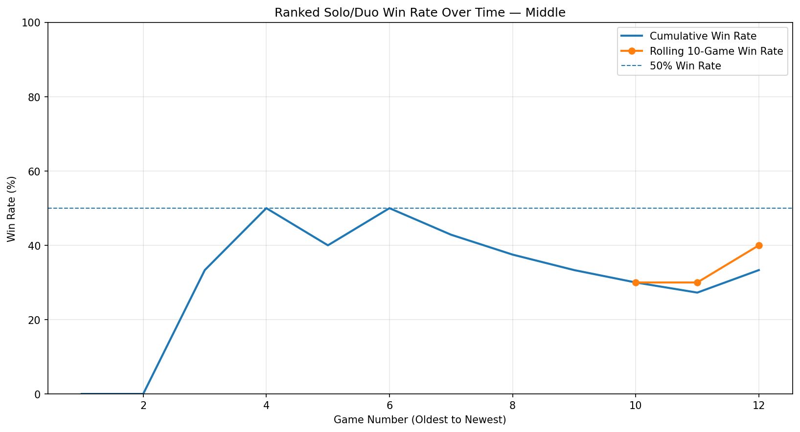
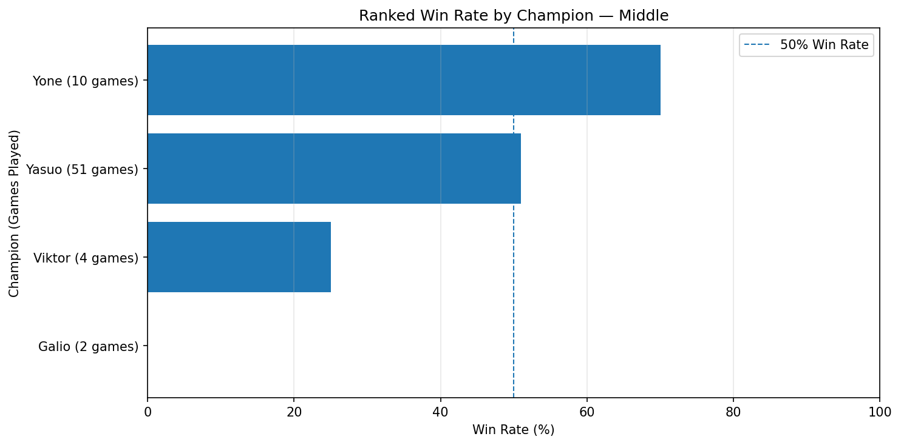
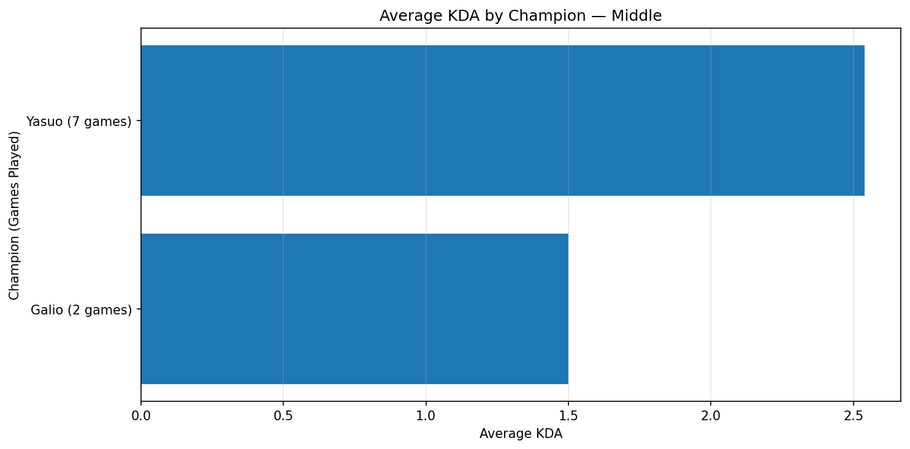
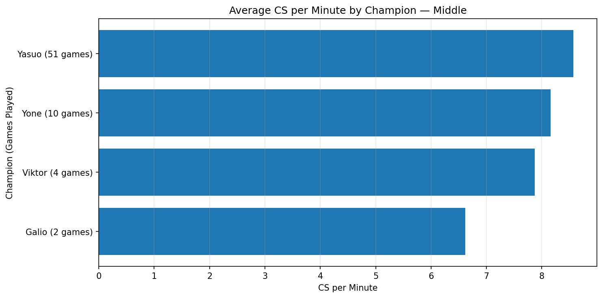

# League of Legends Performance Analyzer

A Python and SQL analytics project that analyzes ranked League of Legends match history using the Riot Games API and MySQL.

## Project Overview

This project imports ranked solo/duo match data, stores it in a MySQL database, and analyzes gameplay performance using Python. It generates reports and visualizations to identify trends in win rate, champion performance, and differences between wins and losses.

## Features

- **Automated Data Import:** Retrieves ranked match data through the Riot Games API.
- **MySQL Database:** Stores match history and prevents duplicate records during repeated imports.
- **Performance Analytics:** Calculates win rate, KDA, CS per minute, gold per minute, and damage per minute.
- **Champion Analysis:** Compares champion performance using games played, win rate, and other performance metrics.
- **Trend Visualization:** Plots cumulative and rolling 10-game win rates.
- **Win/Loss Comparison:** Compares performance statistics between wins and losses.
- **Data Quality Checks:** Checks for missing values and duplicate match IDs.
- **Automated Testing:** Uses pytest to validate analytical functions.

## Visualizations

### Ranked Win Rate Trends


### Champion Win Rate


### Champion KDA


### Champion CS per Minute


## Technologies Used

- Python
- SQL and MySQL
- pandas
- matplotlib
- Riot Games API
- pytest
- Git and GitHub

## Project Structure

| File | Purpose |
|---|---|
| `import_ranked_matches.py` | Imports ranked match data into MySQL |
| `analyze_matches.py` | Calculates performance metrics and exports reports |
| `plot_win_rate.py` | Visualizes win-rate trends |
| `plot_champion_stats.py` | Visualizes champion performance |
| `config.py` | Configures the role used for analysis |
| `test_analysis.py` | Tests analytical functions |

## Setup

1. Install Python and MySQL.
2. Install the required Python packages:

   ```bash
   pip install requests python-dotenv mysql-connector-python pandas matplotlib pytest
   ```

3. Create a local `.env` file containing your Riot API key and MySQL connection settings. Never upload this file to GitHub.
4. Create the `lol_analytics` database and the `matches` table expected by the import script.
5. Run the importer:

   ```bash
   python import_ranked_matches.py
   ```

6. Run the analysis:

   ```bash
   python analyze_matches.py
   ```

7. Generate the charts:

   ```bash
   python plot_win_rate.py
   python plot_champion_stats.py
   ```

8. Run the tests:

   ```bash
   python -m pytest -v test_analysis.py
   ```

## Security

API keys and database credentials are stored locally in `.env`, which is excluded from version control.

## Future Improvements

- Expand analysis across multiple accounts.
- Explore matchup-specific trends.
- Add more analytical tests and reports.
- Develop an interactive performance dashboard.
